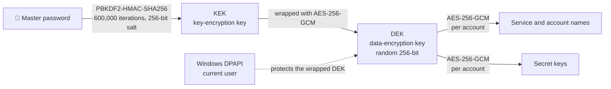

<div align="center">


# TOTP Vault

**A secure two-factor authentication (TOTP) code manager for Windows 10 / 11**

[](#-getting-started)
[](#-building-from-source)
[](#-tech-stack)
[](docs/TEST_RESULTS.md)
[](#-security-design)
[](#-faq)
[](#-changelog)

[日本語](README.md) ｜ **English**

[Download](#-getting-started) · [Features](#-features) · [Usage](#-usage) · [Security](#-security-design) · [Build](#-building-from-source) · [FAQ](#-faq)

</div>

---

## 📌 Overview

**TOTP Vault** generates two-factor authentication codes on the Windows desktop, just like Google Authenticator.
Register a service's QR code or secret key, and the app shows the 6–8 digit code you need to sign in.

A leaked secret key lets anyone generate your codes, so the app is designed to **protect secrets consistently at every stage — storage, decryption, display, copying and backup**.

- 💾 **Single executable** — no installation, no .NET runtime required (about 60 MB)
- 🔒 **Everything encrypted** — not only secret keys, but also service and account names
- 📴 **Fully offline** — the app never connects to the internet
- 🇯🇵 **Japanese UI** — full-width input is normalized automatically; search ignores hiragana/katakana differences

---

## 🖼 Screenshots

<table>
  <tr>
    <td align="center" width="50%">
      <br>
      <b>Account list</b><br>
      <sub>Favorites pinned to the top; a ring shows the time remaining</sub>
    </td>
    <td align="center" width="50%">
      <br>
      <b>One-click copy</b><br>
      <sub>Copied codes are cleared from the clipboard after 20 seconds</sub>
    </td>
  </tr>
  <tr>
    <td align="center">
      <br>
      <b>Many ways to add accounts</b><br>
      <sub>Screen scan, image file, paste, manual entry, restore from backup</sub>
    </td>
    <td align="center">
      <br>
      <b>Add from a QR code</b><br>
      <sub>Review what was read and preview the generated code</sub>
    </td>
  </tr>
  <tr>
    <td align="center">
      <br>
      <b>First-run setup</b><br>
      <sub>Password strength meter and an explicit acknowledgement step</sub>
    </td>
    <td align="center">
      <br>
      <b>Lock screen</b><br>
      <sub>Auto-lock, also triggered when Windows locks (Win+L)</sub>
    </td>
  </tr>
</table>

<sub>Screenshots were taken in a development environment. Fonts and icons differ slightly between Windows versions.</sub>

---

## ✨ Features

### 🗂 Account management

| Feature | Details |
|---|---|
| Add from QR code | **Scan a QR code on screen**, pick an image file, paste a screenshot (Ctrl+V), or drag and drop onto the window |
| Migrate from Google Authenticator | Import **several accounts at once** from its export QR code (`otpauth-migration://`) |
| Manual entry | Type the secret key (full-width, lowercase, spaces and hyphens are normalized). Pasting an `otpauth://` URI also works |
| Edit / delete | Edit service name, account name and advanced settings. Deletion asks for confirmation |
| Search | Filter by service or account name (ignores case, full/half width and hiragana/katakana) |
| Organize | Favorites pinned to the top; custom / name / newest sort; move up and down |
| Duplicate check | Warns if the same secret key is already registered; skipped automatically on bulk import and restore |

### 🔢 Codes

- **RFC 6238** TOTP — **SHA-1 / SHA-256 / SHA-512**, **6–8 digits**, refresh interval **10–300 seconds**
- Auto-refresh with a countdown ring; **turns red in the last 5 seconds** and **shows the next code early**
- Click a card to copy; the add/edit dialog previews the generated code

### 🔐 App lock

- Master password set on first launch (8+ characters, strength meter, confirmation)
- Lock screen on startup, with a Caps Lock warning
- **Increasing delays after repeated failures** (from the 3rd attempt: 2 s → 4 s → 8 s … up to 60 s)
- **Auto-lock after inactivity** (1–30 min, or off), **lock when Windows locks or sleeps**, optional lock on minimize
- Locking closes open dialogs and wipes the displayed codes and the in-memory key
- Changing the master password also generates a new data key and re-encrypts everything

### 💾 Backup and restore

- Backup files (`.tvbackup`) are **encrypted independently with their own password**
- Not tied to the PC, so they can be used to **move to another Windows PC**
- Wrong passwords, corruption and tampering are detected; already-registered accounts are skipped on restore
- Shows the last backup date and recommends a backup if none exists or it is older than 30 days

---

## 🚀 Getting started

### Requirements

| Item | Details |
|---|---|
| OS | Windows 10 (version 1607 or later) / Windows 11, 64-bit |
| Prerequisites | None (the .NET runtime is bundled) |
| Disk space | About 100 MB (including temporary files at runtime) |
| Network | Not required |

### Installation

1. Download `TotpVault-Demo-1.0.0-win-x64.zip` from [**Releases**](../../releases/latest) and extract it.
2. Double-click `TotpVault.exe` (no installation needed).

> [!NOTE]
> On first launch Windows SmartScreen may show **"Windows protected your PC"**, because the demo build is not code-signed.
> Click **"More info" → "Run anyway"** to start it.

### Demo QR codes

The [`samples/`](samples) folder contains QR codes for trying the app (test data, not linked to any real account).

| File | Contents |
|---|---|
| [`01-github.png`](samples/01-github.png) | Standard TOTP (SHA-1 / 6 digits / 30 s) |
| [`02-sample-bank-sha256-8digits.png`](samples/02-sample-bank-sha256-8digits.png) | SHA-256 / 8 digits, Japanese service name |
| [`03-google-authenticator-migration-3accounts.png`](samples/03-google-authenticator-migration-3accounts.png) | Google Authenticator migration format (3 accounts at once) |

Drag an image onto the window, or display it on screen and choose **追加 (Add) → 画面上のQRコードをスキャン (Scan QR code on screen)**.

---

## 📖 Usage

<details open>
<summary><b>1. First-run setup</b></summary>

1. Enter a **master password** (8+ characters) twice. Aim for at least "普通 (Fair)" on the strength meter.
2. Read the notice (a forgotten password cannot be recovered), tick the checkbox and click **保管庫を作成 (Create vault)**.

</details>

<details open>
<summary><b>2. Add an account</b></summary>

Choose a method from **追加 (Add)** in the top-right corner.

| Method | Steps |
|---|---|
| Scan QR code on screen | Show the service's 2FA QR code (e.g. in your browser) and choose this. The app hides briefly and searches the whole screen |
| Pick a QR image | Select a saved QR image (PNG, JPEG, …) (Ctrl+O) |
| Paste from clipboard | Snip the QR with Win+Shift+S, then choose this (Ctrl+V). `otpauth://` URI text also works |
| Enter the secret key | Type the key shown by the service, e.g. `JBSW Y3DP EHPK 3PXP` (Ctrl+N) |
| Drag and drop | Drop a QR image onto the window |

Check the code preview and click **追加する (Add)**. If the service asks for a confirmation code, enter the code shown to finish.

</details>

<details open>
<summary><b>3. Use a code</b></summary>

- **Click a card to copy its code**, then paste it into the sign-in page.
- The code is **cleared from the clipboard after 20 seconds** (unless you copied something else in the meantime).
- In the last 5 seconds the code turns red and the **next code** appears below it.

</details>

<details>
<summary><b>4. Organize accounts</b></summary>

- Click ☆ to add an account to **favorites**; favorites are shown at the top.
- Type in the search box (Ctrl+F) to filter by service or account name.
- Sort by custom order, name or newest. In custom order, use 上へ移動 / 下へ移動 (Move up / down) from the right-click or "…" menu.
- The same menu offers **edit** and **delete**.

> [!WARNING]
> After deleting an account you can no longer generate its codes. Disable 2FA on the service or move it to another authenticator first.

</details>

<details>
<summary><b>5. Lock and unlock</b></summary>

- Lock immediately with the 🔒 button (Ctrl+L).
- The app also locks after inactivity (5 minutes by default) and when Windows is locked (Win+L) or goes to sleep.
- Repeated wrong passwords make you wait progressively longer before trying again.

</details>

<details>
<summary><b>6. Backup and restore (moving to another PC)</b></summary>

**Create a backup**

1. Choose **Settings → バックアップを作成… (Create backup)** (also in the Add menu).
2. Pick a location and set a **backup password** (required to restore).

**Restore**

1. Launch TOTP Vault on the new PC and set a master password.
2. Choose **バックアップから復元 (Restore from backup)**, then select the file and enter the backup password.
3. Accounts that already exist are skipped; the rest are added.

> [!TIP]
> Keep backup files somewhere other than the PC itself, such as a USB drive. They are the only way to recover after a hardware failure or a forgotten master password.

</details>

<details>
<summary><b>7. Settings</b></summary>

| Setting | Default | Description |
|---|---|---|
| Auto-lock | 5 min | Lock after inactivity (1 / 3 / 5 / 10 / 15 / 30 min, or off) |
| Clipboard auto-clear | 20 s | Time before a copied code is cleared (10 / 20 / 30 / 60 s, or off) |
| Lock when Windows locks or sleeps | On | Lock on Win+L or sleep |
| Lock on minimize | Off | Lock when the window is minimized |
| Hide from screen capture and sharing | Off | Keep the window out of screenshots and meeting screen shares (Windows 10 2004+) |

</details>

<details>
<summary><b>8. If you forget the master password</b></summary>

For security, the master password is not stored anywhere, and **nobody — including the developer — can reset or recover it**.

- **If you have a backup:** on the lock screen choose パスワードを忘れた場合 (Forgot password) → 保管庫を初期化 (Reset vault), set a new master password, then restore from the backup.
- **If you have no backup:** reset 2FA on each service using its recovery codes or account settings.

</details>

### ⌨ Keyboard shortcuts

| Keys | Action |
|---|---|
| `Ctrl` + `N` | Enter a secret key manually |
| `Ctrl` + `O` | Pick a QR image |
| `Ctrl` + `V` | Add from a QR image or URI on the clipboard |
| `Ctrl` + `F` | Jump to search |
| `Esc` | Clear search |
| `Ctrl` + `L` | Lock now |

---

## 🛡 Security design

### Key hierarchy



| Requirement | Implementation |
|---|---|
| Authenticated encryption | **AES-256-GCM** (built-in .NET crypto API). Tampering and corruption are always detected on decryption |
| Key derivation | **PBKDF2-HMAC-SHA256, 600,000 iterations** (OWASP recommendation). The algorithm name is stored, so a later move to Argon2id is possible |
| Salt | Random 256-bit per derivation; regenerated when the master password changes |
| Nonce reuse prevention | A fresh 96-bit nonce from a CSPRNG for every encryption (uniqueness verified over 10,000 encryptions in tests) |
| Record-swap protection | Associated data (AAD) includes the record type and account ID, so swapped ciphertexts are detected |
| Parameter tampering protection | The key-derivation parameters are bound to the DEK encryption as AAD |
| Binding to the PC and user | **Windows DPAPI** — copying the vault file to another PC does not even allow a password brute-force to begin |
| Moving to another PC | Via a separate backup file encrypted with a password only (no DPAPI) |

### Data storage

- Location: `%LOCALAPPDATA%\TotpVault\vault.db` (SQLite)
- Stored in plain text: **IDs, sort order, key-derivation parameters and app settings only**. Service and account names are encrypted too, so the file does not reveal which services you use
- Deleted records are overwritten with zeros (`PRAGMA secure_delete`)
- A schema version is stored so that data from a newer version is never opened by mistake
- There is **no** feature that writes secret keys to unencrypted JSON or CSV

### Clipboard, memory and logs

- Copied codes are cleared after a set time. **Content copied by other apps is never cleared** (checked via the clipboard sequence number)
- Codes are copied **excluded** from Windows clipboard history (Win+V) and cloud sync
- While unlocked, secret keys stay **encrypted in memory** and are decrypted only at the moment a code is generated, then zeroed immediately
- Keys and decrypted data live in pinned memory that the GC cannot move, and are zeroed after use
- The master password goes straight from `SecureString` to UTF-8 bytes and is never kept as a regular string
- Logs contain only event types and internal IDs — **never secret keys, codes, passwords or service names** (verified by an automated test)

### What it protects against

| ✅ Protected | ⚠️ Not protected |
|---|---|
| Copying or stealing `vault.db` (it cannot be opened on another PC or by another user) | Malware or keyloggers running on the PC while the vault is unlocked |
| Tampering with stored data or backups (always detected) | An attacker with full administrator control of the PC |
| Theft of a backup file (cannot be decrypted without its password) | A weak, guessable master password (brute force is slowed down significantly, not prevented) |
| Shoulder surfing while you are away (auto-lock, Win+L) | |
| Codes lingering in clipboard history or cloud sync | |

> [!IMPORTANT]
> In .NET managed memory, not every copy of sensitive data can be guaranteed to be erased.
> The app does not promise perfect protection; it is designed to reduce risk with the measures above.

---

## ✅ Requirements coverage

| Requirement | Status | Notes |
|---|:---:|---|
| Add, edit, delete, list, search, favorite, sort accounts | ✅ | |
| Add from a QR code (image file) | ✅ | Also screen scan, paste, drag and drop |
| Add from a QR code (webcam) | 🔜 | Next phase |
| Manual secret key entry | ✅ | `otpauth://` URIs and full-width input supported |
| 6 / 8 digits, SHA-1 / SHA-256 / SHA-512 | ✅ | 7 digits supported too |
| Auto-refresh, time remaining, one-click copy | ✅ | |
| Per-account refresh interval | ✅ | 10–300 s |
| Master password (setup, startup unlock, change) | ✅ | |
| Auto-lock, hidden content while locked | ✅ | Also tied to Windows lock and sleep |
| Forgotten-password policy | ✅ | No recovery, by design; guides the user to restore from backup |
| Windows Hello unlock | 🔜 | Next phase |
| Encrypted backup, restore, error handling, moving to another PC | ✅ | |
| AES-256-GCM, PBKDF2, salt and nonce management, DPAPI | ✅ | |
| SQLite, encrypted storage, versioned data format | ✅ | |
| Clipboard auto-clear, memory and log protection | ✅ | |
| Verification with RFC 6238 test vectors | ✅ | [Test results](docs/TEST_RESULTS.md) |
| Installer | ✅ | Inno Setup script included ([`installer/`](installer)) |
| Third-party security audit | — | Out of scope (recommended separately) |

---

## 🧪 Tests

`tests/TotpVault.Core.Tests` (xUnit) contains **151 automated tests, all passing**. See **[test results](docs/TEST_RESULTS.md)** (Japanese) for the full list.

| Area | Tests | Highlights |
|---|---:|---|
| TOTP / HOTP generation | 40 | **All RFC 6238 Appendix B test vectors** (SHA-1 / 256 / 512), RFC 4226 |
| Base32 | 18 | RFC 4648 vectors, normalization of full-width/lowercase/separators, rejection of invalid input |
| QR content parsing | 22 | `otpauth://` and Google Authenticator migration format, rejection of invalid QR codes |
| AES-256-GCM | 9 | Round trip, nonce uniqueness, tamper detection in every part, wrong key/AAD |
| Key derivation | 14 | Published PBKDF2 test vector, rejection of abnormal parameters |
| Encrypted vault | 16 | No plain text on disk; detection of swapped, tampered and corrupted records; password change |
| Backup | 12 | Round trip, wrong password, tampering and corruption, migration to another PC with duplicate skipping |
| QR image decoding | 7 | Inverted colors, transparent background, screen captures, multiple QR codes |
| Security policies | 12 | Auto-lock, failure delays, clipboard clearing, password strength |
| Logging | 1 | No sensitive data in logs |

```bash
dotnet test
```

---

## 🔧 Building from source

**Requirement:** [.NET 10 SDK](https://dotnet.microsoft.com/download/dotnet/10.0) (builds on Windows, macOS or Linux)

```bash
# Run the tests
dotnet test

# Build the distributable exe (creates dist/TotpVault.exe)
dotnet publish src/TotpVault.App -c Release -o dist
```

On Windows, the included script runs the tests and builds the exe in one step:

```powershell
.\build.ps1              # tests + dist\TotpVault.exe
.\build.ps1 -Installer   # also builds the installer (requires Inno Setup 6)
```

> [!NOTE]
> The installer **does not delete** the vault data in `%LOCALAPPDATA%\TotpVault` on uninstall, so an accidental uninstall never loses your credentials.

---

## 📁 Project structure

```text
TotpVault/
├── src/
│   ├── TotpVault.Core/            # UI-independent logic (covered by tests)
│   │   ├── Otp/                   #   Base32, TOTP (RFC 6238), otpauth / migration QR parsing
│   │   ├── Security/              #   AES-GCM, PBKDF2, DPAPI abstraction, lock/clipboard policies
│   │   ├── Storage/               #   SQLite vault, encrypted backup
│   │   ├── Qr/                    #   QR image decoding
│   │   └── Logging/               #   Logging without sensitive data
│   └── TotpVault.App/             # WPF app (MVVM)
│       ├── Views/  ViewModels/    #   Screens and their logic
│       ├── Services/              #   DPAPI, clipboard, screen capture, dialogs
│       ├── Controls/  Themes/     #   Countdown ring, strength meter, styles
│       └── Assets/                #   Icons
├── tests/TotpVault.Core.Tests/    # Automated tests (151)
├── installer/                     # Installer (Inno Setup)
├── samples/                       # Demo QR codes
├── docs/                          # Test results and images
├── build.ps1 / build.sh           # Build scripts
└── TotpVault.slnx                 # Solution
```

---

## 🧰 Tech stack

| Area | Technology |
|---|---|
| Language and UI | C# / WPF (MVVM) / .NET 10 LTS |
| Storage | SQLite (Microsoft.Data.Sqlite) |
| Cryptography | Built-in .NET crypto (Windows CNG): AES-GCM, PBKDF2, HMAC, CSPRNG; Windows DPAPI |
| QR codes | ZXing.Net |
| Tests | xUnit |
| Distribution | Self-contained single exe (win-x64), Inno Setup |

### Libraries and licenses

| Library | Purpose | License |
|---|---|---|
| [Microsoft.Data.Sqlite](https://www.nuget.org/packages/Microsoft.Data.Sqlite) | Local database | MIT |
| [ZXing.Net](https://github.com/micjahn/ZXing.Net) | QR code decoding | Apache-2.0 |
| [System.Security.Cryptography.ProtectedData](https://www.nuget.org/packages/System.Security.Cryptography.ProtectedData) | Windows DPAPI | MIT |
| [xUnit](https://xunit.net/) (tests only) | Automated tests | Apache-2.0 |

All cryptography uses the built-in .NET APIs; there are no custom algorithms or third-party crypto implementations.

---

## ❓ FAQ

<details>
<summary><b>Does it connect to the internet?</b></summary>

No. TOTP Vault **makes no network connections at all**. All data stays on your PC.

</details>

<details>
<summary><b>Can I migrate from Google Authenticator?</b></summary>

Yes. In Google Authenticator on your phone, choose **export accounts (transfer)** from the menu to show a QR code. Load a photo of it, or display it on your PC screen and choose "Scan QR code on screen". Several accounts are added at once.

</details>

<details>
<summary><b>How do I move to another PC?</b></summary>

**Create a backup** on the old PC and **restore it** on the new one. Copying the vault file (`vault.db`) directly does not work: Windows DPAPI prevents it from being opened on another PC.

</details>

<details>
<summary><b>The code shown doesn't work when I sign in.</b></summary>

TOTP codes are based on the PC's clock, so **a clock that is off produces wrong codes**. In Windows, open Settings → Time & language → Date & time and click "Sync now".

</details>

<details>
<summary><b>Where is my data stored?</b></summary>

In `%LOCALAPPDATA%\TotpVault\`:

| File | Contents |
|---|---|
| `vault.db` | The encrypted vault |
| `logs\app.log` | Activity log (no sensitive data) |

To use a different folder for testing, start the app as `TotpVault.exe --data-dir "D:\test-data"`.

</details>

<details>
<summary><b>Is HOTP (counter-based) supported?</b></summary>

Only time-based **TOTP** is supported for now. If you scan an HOTP QR code, the app explains this and does not add it.

</details>

---

## 🗺 Roadmap

- [ ] Unlock with Windows Hello
- [ ] Scan QR codes with a webcam
- [ ] Code signing (removes the SmartScreen warning)
- [ ] Move key derivation to Argon2id (the data format already allows it)
- [ ] System tray mode and a global hotkey
- [ ] Third-party security audit and penetration test

---

## 📝 Changelog

### v1.0.0 (demo) — 2026-10-13

- Initial release

---

## 👤 Author

**DevX**

Questions, requests and bug reports are welcome via [Issues](../../issues).

---

<div align="center">

© 2026 DevX. All rights reserved.<br>
<sub>Google Authenticator is a trademark of Google LLC. This software is not affiliated with Google.</sub>

</div>
