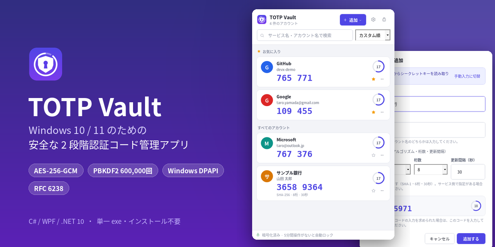
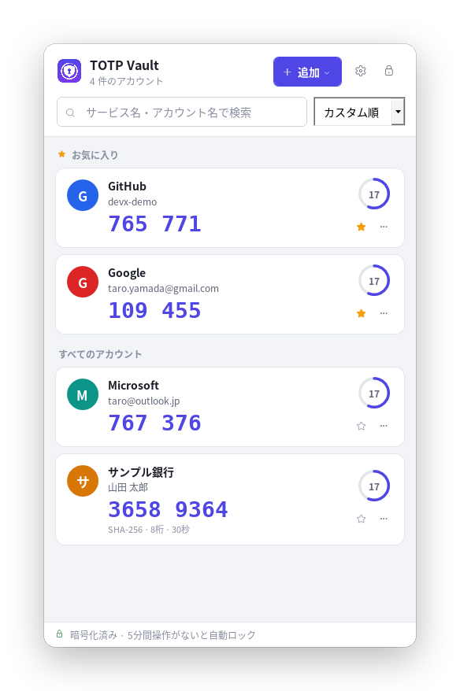
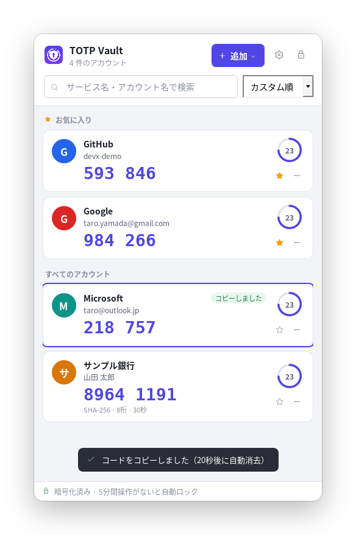
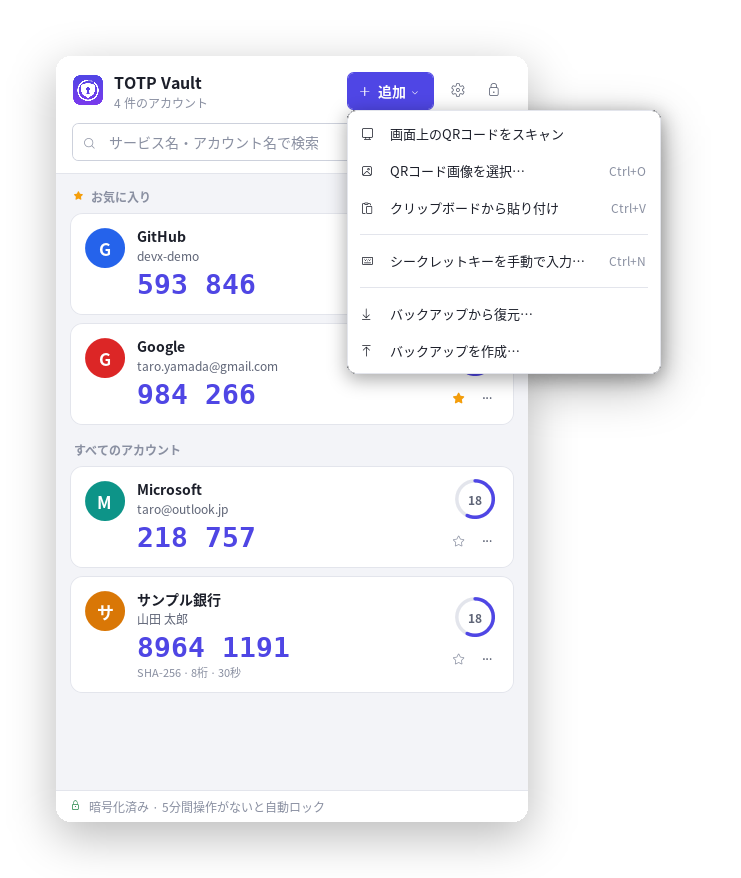
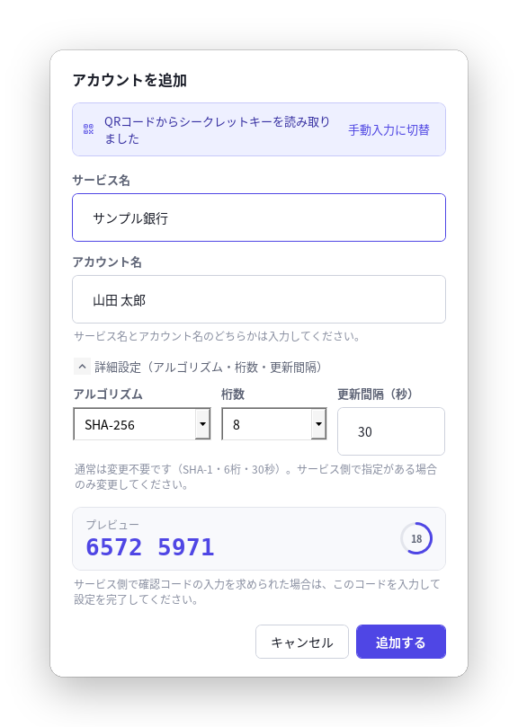
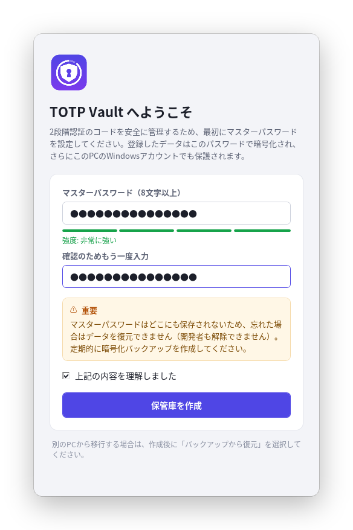
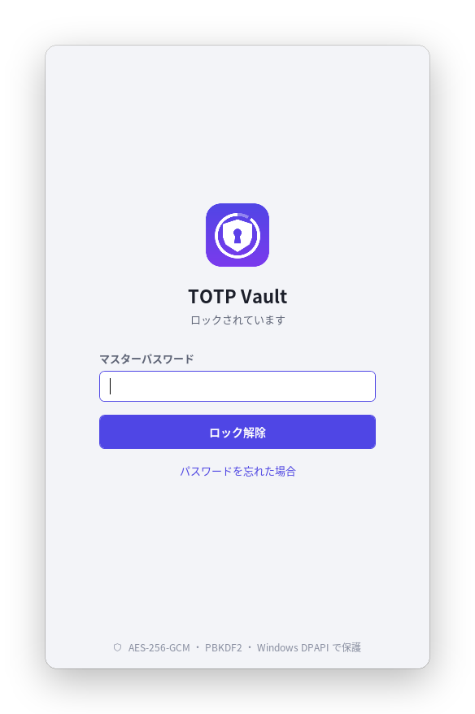
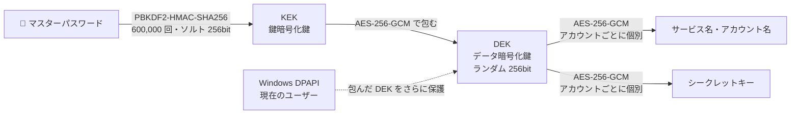

<div align="center">



# TOTP Vault

**Windows 10 / 11 のための、安全な 2 段階認証（TOTP）コード管理アプリ**

[](#-はじめかた)
[](#-ビルド方法)
[](#-技術スタック)
[](docs/TEST_RESULTS.md)
[](#-セキュリティ設計)
[](#-よくある質問)
[](#-更新履歴)

**日本語** ｜ [English](README.en.md)

[ダウンロード](#-はじめかた) ・ [機能](#-主な機能) ・ [使い方](#-使い方) ・ [セキュリティ](#-セキュリティ設計) ・ [ビルド](#-ビルド方法) ・ [FAQ](#-よくある質問)

</div>

---

## 📌 概要

**TOTP Vault** は、Google Authenticator と同等の 2 段階認証コード生成を Windows デスクトップで行うアプリです。
各サービスの QR コードやシークレットキーを登録すると、ログインに必要な 6〜8 桁の認証コードを自動で表示します。

認証情報（シークレットキー）が漏えいすると第三者に認証コードを生成されてしまうため、
**保存・復号・表示・コピー・バックアップのすべての段階で一貫した保護**を行うことを最優先に設計しています。

- 💾 **単一の exe で動作** — インストール不要・.NET ランタイム不要（約 60 MB）
- 🔒 **すべてのデータを暗号化** — シークレットキーだけでなく、サービス名・アカウント名も暗号化
- 📴 **完全オフライン** — インターネット通信を一切行いません
- 🇯🇵 **日本語 UI** — 全角入力の自動補正、ひらがな/カタカナを区別しない検索

---

## 🖼 スクリーンショット

<table>
  <tr>
    <td align="center" width="50%">
      <br>
      <b>アカウント一覧</b><br>
      <sub>お気に入りを上部に固定。残り時間をリングで表示</sub>
    </td>
    <td align="center" width="50%">
      <br>
      <b>ワンクリックでコピー</b><br>
      <sub>コピーしたコードは 20 秒後に自動消去</sub>
    </td>
  </tr>
  <tr>
    <td align="center">
      <br>
      <b>多彩な登録方法</b><br>
      <sub>画面スキャン・画像・貼り付け・手動入力・バックアップから復元</sub>
    </td>
    <td align="center">
      <br>
      <b>QR コードから登録</b><br>
      <sub>読み取った内容を確認し、生成コードをプレビュー</sub>
    </td>
  </tr>
  <tr>
    <td align="center">
      <br>
      <b>初回設定</b><br>
      <sub>マスターパスワードの強度を表示し、注意事項への同意を確認</sub>
    </td>
    <td align="center">
      <br>
      <b>ロック画面</b><br>
      <sub>自動ロック・Windows のロック（Win+L）と連動</sub>
    </td>
  </tr>
</table>

<sub>※ 画面は開発環境で撮影したものです。フォントやアイコンの細部は Windows のバージョンによって若干異なります。</sub>

---

## ✨ 主な機能

### 🗂 アカウント管理

| 機能 | 内容 |
|---|---|
| QR コードから登録 | **画面上の QR をスキャン**、画像ファイルの選択、スクリーンショットの貼り付け（Ctrl+V）、ウィンドウへのドラッグ＆ドロップ |
| Google Authenticator から移行 | エクスポート（移行）用の QR コード（`otpauth-migration://`）から**複数アカウントを一括登録** |
| 手動登録 | シークレットキーを入力（全角・小文字・空白・ハイフンを自動補正）。`otpauth://` URI の貼り付けにも対応 |
| 編集・削除 | サービス名・アカウント名・詳細設定の編集。削除時は確認ダイアログを表示 |
| 検索 | サービス名・アカウント名で絞り込み（大文字/小文字・全角/半角・ひらがな/カタカナを区別しない） |
| 整理 | お気に入り（上部に固定表示）、並び順（カスタム順・名前順・新しい順）、上下への移動 |
| 重複チェック | 同じシークレットキーが登録済みの場合は警告。一括登録・復元時は自動でスキップ |

### 🔢 認証コード

- **RFC 6238 準拠**の TOTP 生成 — **SHA-1 / SHA-256 / SHA-512**、**6〜8 桁**、更新間隔 **10〜300 秒**
- 自動更新と残り時間のリング表示。**残り 5 秒で赤色表示**し、**次のコードを先行表示**
- カードをクリックするだけでコピー。登録画面では生成コードをプレビューして確認可能

### 🔐 アプリロック

- 初回起動時にマスターパスワードを設定（8 文字以上・強度メーター・確認入力）
- 起動時のロック画面（Caps Lock の警告付き）
- **連続失敗時は待機時間を段階的に延長**（3 回目から 2 秒 → 4 秒 → 8 秒 … 最大 60 秒）
- **自動ロック**（1〜30 分、無効も可）、**Windows のロック・スリープ時に自動ロック**、最小化時のロック（任意）
- ロック時は開いている画面を閉じ、表示中のコードとメモリ上の鍵を消去
- マスターパスワードの変更（変更時にデータ暗号鍵も新しく生成し、全データを再暗号化）

### 💾 バックアップ・復元

- バックアップファイル（`.tvbackup`）は**専用のパスワードで独立して暗号化**
- PC に依存しないため、**別の Windows PC への移行**にも使用可能
- パスワード誤り・破損・改ざんを検出してエラー表示。復元時は登録済みのアカウントをスキップ
- 最終バックアップ日時を表示し、未作成または 30 日以上経過している場合は作成を推奨

---

## 🚀 はじめかた

### 動作環境

| 項目 | 内容 |
|---|---|
| OS | Windows 10（バージョン 1607 以降）/ Windows 11（64bit） |
| 必要なソフトウェア | なし（.NET ランタイムは exe に同梱） |
| ディスク容量 | 約 100 MB（実行時の一時ファイルを含む） |
| ネットワーク | 不要 |

### インストール

1. [**Releases**](../../releases/latest) から `TotpVault-Demo-1.0.0-win-x64.zip` をダウンロードして展開します。
2. `TotpVault.exe` をダブルクリックして起動します（インストール作業は不要です）。

> [!NOTE]
> 初回起動時に **「Windows によって PC が保護されました」**（SmartScreen）と表示される場合があります。
> デモ版はコード署名を行っていないためです。**「詳細情報」→「実行」** をクリックすると起動できます。

### デモ用 QR コード

[`samples/`](samples) フォルダに動作確認用の QR コード画像を用意しています（実在のアカウントとは関係のないテスト用データです）。

| ファイル | 内容 |
|---|---|
| [`01-github.png`](samples/01-github.png) | 標準的な TOTP（SHA-1 / 6 桁 / 30 秒） |
| [`02-sample-bank-sha256-8digits.png`](samples/02-sample-bank-sha256-8digits.png) | SHA-256 / 8 桁、日本語のサービス名 |
| [`03-google-authenticator-migration-3accounts.png`](samples/03-google-authenticator-migration-3accounts.png) | Google Authenticator の移行形式（3 件を一括登録） |

画像をウィンドウにドラッグ＆ドロップするか、画像を画面に表示した状態で **「追加」→「画面上の QR コードをスキャン」** を選ぶと登録できます。

---

## 📖 使い方

<details open>
<summary><b>1. 初回設定</b></summary>

1. 初回起動時に **マスターパスワード**（8 文字以上）を 2 回入力します。強度メーターが「普通」以上になるように設定してください。
2. 注意事項（パスワードを忘れると復元できないこと）を確認してチェックを入れ、**「保管庫を作成」** をクリックします。

</details>

<details open>
<summary><b>2. アカウントを登録する</b></summary>

右上の **「追加」** から登録方法を選びます。

| 方法 | 手順 |
|---|---|
| 画面上の QR コードをスキャン | サービスの 2 段階認証設定画面（ブラウザ等）に QR コードを表示した状態で選択。アプリが一時的に隠れて画面全体から QR を探します |
| QR コード画像を選択 | 保存した QR コード画像（PNG / JPEG など）を選択（Ctrl+O） |
| クリップボードから貼り付け | Win+Shift+S で QR を切り取った後に選択（Ctrl+V）。`otpauth://` URI のテキストにも対応 |
| シークレットキーを手動で入力 | サービスに表示されたキー（例: `JBSW Y3DP EHPK 3PXP`）を入力（Ctrl+N） |
| ドラッグ＆ドロップ | QR コード画像をウィンドウにドロップ |

登録画面で生成コードのプレビューを確認し、**「追加する」** をクリックします。
サービス側で確認コードの入力を求められた場合は、表示されているコードを入力して設定を完了してください。

</details>

<details open>
<summary><b>3. 認証コードを使う</b></summary>

- カードを**クリックするとコードがコピー**されます。そのままログイン画面に貼り付けてください。
- コピーしたコードは **20 秒後にクリップボードから自動で消去**されます（その間に別の内容をコピーした場合は消去しません）。
- 残り 5 秒になるとコードが赤色になり、**次のコード**が下に表示されます。

</details>

<details>
<summary><b>4. アカウントを整理する</b></summary>

- ☆ をクリックすると**お気に入り**に追加され、一覧の上部に表示されます。
- 検索欄（Ctrl+F）にサービス名やアカウント名を入力すると絞り込めます。
- 並び順は「カスタム順・名前順・新しい順」から選べます。カスタム順では右クリック（または「…」）メニューの「上へ移動 / 下へ移動」で並べ替えます。
- 同じメニューから **編集** と **削除** ができます。

> [!WARNING]
> アカウントを削除すると、そのサービスの認証コードを生成できなくなります。削除する前に、サービス側で 2 段階認証を無効化するか、別の認証アプリへ移行してください。

</details>

<details>
<summary><b>5. ロックとロック解除</b></summary>

- 右上の 🔒 ボタン（Ctrl+L）ですぐにロックできます。
- 一定時間操作がない場合（既定 5 分）や、Windows をロック（Win+L）・スリープした場合も自動でロックされます。
- パスワードを連続で間違えると、再入力までの待機時間が段階的に長くなります。

</details>

<details>
<summary><b>6. バックアップと復元（別の PC への移行）</b></summary>

**バックアップの作成**

1. **設定 → 「バックアップを作成…」**（または「追加」メニュー）を選びます。
2. 保存先を選び、**バックアップ用パスワード**を設定します（復元時に必要です）。

**復元**

1. 新しい PC で TOTP Vault を起動し、マスターパスワードを設定します。
2. **「バックアップから復元」** を選び、バックアップファイルとバックアップ用パスワードを入力します。
3. 登録済みのアカウントは自動でスキップされ、残りが追加されます。

> [!TIP]
> バックアップファイルは USB メモリなど、PC 本体とは別の場所に保管してください。PC の故障やマスターパスワードを忘れた場合の唯一の復旧手段になります。

</details>

<details>
<summary><b>7. 設定項目</b></summary>

| 設定 | 既定値 | 説明 |
|---|---|---|
| 自動ロック | 5 分 | 一定時間操作がない場合にロック（1 / 3 / 5 / 10 / 15 / 30 分、無効） |
| クリップボードの自動消去 | 20 秒後 | コピーしたコードを消去するまでの時間（10 / 20 / 30 / 60 秒、無効） |
| Windows のロック・スリープ時にロック | オン | Win+L やスリープで自動的にロック |
| 最小化したときにロック | オフ | ウィンドウを最小化したときにロック |
| 画面キャプチャ・画面共有に表示しない | オフ | スクリーンショットや Web 会議の画面共有にウィンドウを映さない（Windows 10 2004 以降） |

</details>

<details>
<summary><b>8. マスターパスワードを忘れた場合</b></summary>

安全のため、マスターパスワードはどこにも保存されておらず、**開発者を含め誰も解除・再発行できません**。

- **バックアップがある場合**: ロック画面の「パスワードを忘れた場合」→「保管庫を初期化」で初期化し、新しいマスターパスワードを設定した後、バックアップから復元します。
- **バックアップがない場合**: 各サービスのアカウント設定画面で、リカバリーコード等を使って 2 段階認証を再設定してください。

</details>

### ⌨ キーボードショートカット

| キー | 操作 |
|---|---|
| `Ctrl` + `N` | シークレットキーを手動で入力 |
| `Ctrl` + `O` | QR コード画像を選択 |
| `Ctrl` + `V` | クリップボードの QR 画像・URI から登録 |
| `Ctrl` + `F` | 検索欄に移動 |
| `Esc` | 検索をクリア |
| `Ctrl` + `L` | 今すぐロック |

---

## 🛡 セキュリティ設計

### 鍵の階層構造



| 要件 | 実装 |
|---|---|
| 認証付き暗号 | **AES-256-GCM**（.NET 標準の暗号 API）。改ざん・破損は復号時に必ず検出 |
| 鍵導出 | **PBKDF2-HMAC-SHA256 600,000 回**（OWASP 推奨値）。方式名を保存しており、将来 Argon2id 等へ移行可能 |
| ソルト | 鍵導出ごとにランダム 256bit。マスターパスワード変更時にも再生成 |
| nonce の再利用防止 | 暗号化のたびに 96bit を暗号論的乱数で生成（テストで 10,000 回の一意性を確認） |
| 差し替え攻撃の防止 | 関連データ（AAD）にレコード種別とアカウント ID を含め、暗号文の入れ替えを検出 |
| パラメータ改ざんの防止 | 鍵導出パラメータ自体を AAD として DEK の暗号化に結び付け |
| PC・ユーザーへの紐付け | **Windows DPAPI**。保管庫ファイルを別の PC にコピーしても、パスワードの総当たりすら開始できない |
| 別 PC への移行 | DPAPI を使わない、パスワードのみで暗号化した独立のバックアップファイルで実施 |

### データの保存

- 保存先: `%LOCALAPPDATA%\TotpVault\vault.db`（SQLite）
- 平文で保存されるのは **ID・並び順・鍵導出パラメータ・アプリ設定のみ**。サービス名やアカウント名も暗号化されるため、ファイルを見ても利用サービスは分かりません
- 削除したデータ領域はゼロで上書き（`PRAGMA secure_delete`）
- データ形式のバージョンを保持し、新しいバージョンで作成されたデータを誤って開かない
- 暗号化されていない JSON / CSV へシークレットキーを書き出す機能は**ありません**

### クリップボード・メモリ・ログ

- コピーしたコードは指定時間後に自動消去。**他のアプリでコピーした内容は消去しない**（クリップボードの更新番号で判定）
- Windows のクリップボード履歴（Win+V）とクラウド同期の**対象外**としてコピー
- ロック解除中もシークレットキーは**暗号化したままメモリに保持**し、コード生成の瞬間だけ復号して直ちにゼロ消去
- 鍵や復号したデータは GC に移動されない固定メモリに置き、使用後にゼロ消去
- マスターパスワードは `SecureString` から直接 UTF-8 に変換し、通常の文字列として残さない
- ログに記録するのはイベント種別と内部 ID のみ。**シークレットキー・コード・パスワード・サービス名は記録しない**（自動テストで検証）

### 保護できる範囲

| ✅ 保護できるもの | ⚠️ 保護できないもの |
|---|---|
| `vault.db` の持ち出し・コピー（別 PC・別ユーザーでは開けない） | ロック解除中の PC に侵入したマルウェアやキーロガー |
| 保存データ・バックアップファイルの改ざん（必ず検出） | 管理者権限を持つ攻撃者による PC の完全な乗っ取り |
| バックアップファイルの盗難（パスワードなしでは復号不可） | 推測されやすい弱いマスターパスワード（総当たりの所要時間は大幅に延びます） |
| 離席時の覗き見（自動ロック・Win+L 連動） | |
| クリップボード履歴・クラウド同期へのコード残留 | |

> [!IMPORTANT]
> .NET のマネージドメモリでは、すべての機密データのコピーを確実に消去できるとは限りません。
> 本アプリは完全な保護を保証するものではなく、上記の対策によりリスクを低減する設計です。

---

## ✅ 要件への対応状況

| 要件 | 状況 | 備考 |
|---|:---:|---|
| アカウントの登録・編集・削除・一覧・検索・お気に入り・並び替え | ✅ | |
| QR コードからの登録（画像ファイル） | ✅ | 画面スキャン・貼り付け・ドラッグ＆ドロップにも対応 |
| QR コードからの登録（Web カメラ） | 🔜 | 次フェーズ |
| シークレットキーの手動登録 | ✅ | `otpauth://` URI、全角入力にも対応 |
| 6 桁・8 桁、SHA-1 / SHA-256 / SHA-512 | ✅ | 7 桁にも対応 |
| 自動更新・残り時間表示・ワンクリックコピー | ✅ | |
| アカウントごとの更新間隔設定 | ✅ | 10〜300 秒 |
| マスターパスワード（初回設定・起動時認証・変更） | ✅ | |
| 自動ロック・ロック中の非表示 | ✅ | Windows のロック・スリープにも連動 |
| パスワードを忘れた場合の方針 | ✅ | 復旧不可を明示し、バックアップからの復元手順を案内 |
| Windows Hello による解除 | 🔜 | 次フェーズ |
| 暗号化バックアップ・復元・エラー処理・別 PC 移行 | ✅ | |
| AES-256-GCM・PBKDF2・ソルト・nonce 管理・DPAPI | ✅ | |
| SQLite・暗号化保存・データ形式のバージョン管理 | ✅ | |
| クリップボード自動消去・メモリ・ログの保護 | ✅ | |
| RFC 6238 テストベクターによる検証 | ✅ | [テスト結果](docs/TEST_RESULTS.md) |
| インストーラー | ✅ | Inno Setup スクリプトを同梱（[`installer/`](installer)） |
| 第三者によるセキュリティ監査 | — | 対象外（別途実施を推奨） |

---

## 🧪 テスト

`tests/TotpVault.Core.Tests`（xUnit）に **151 件の自動テスト**があり、すべて成功しています。詳細は **[テスト結果](docs/TEST_RESULTS.md)** を参照してください。

| 区分 | 件数 | 主な内容 |
|---|---:|---|
| TOTP / HOTP 生成 | 40 | **RFC 6238 Appendix B の全テストベクター**（SHA-1 / 256 / 512）、RFC 4226 |
| Base32 | 18 | RFC 4648 テストベクター、全角・小文字・区切り文字の補正、不正入力の拒否 |
| QR コード内容の解析 | 22 | `otpauth://`・Google Authenticator 移行形式、不正な QR の拒否 |
| AES-256-GCM | 9 | 往復、nonce の一意性、各部位の改ざん検出、鍵・AAD 違いの検出 |
| 鍵導出 | 14 | PBKDF2 公開テストベクター、異常なパラメータの拒否 |
| 暗号化保管庫 | 16 | 平文が残らないこと、行の差し替え・改ざん・破損の検出、パスワード変更 |
| バックアップ | 12 | 往復、パスワード誤り、改ざん・破損の検出、別 PC への移行と重複スキップ |
| QR コード画像の読み取り | 7 | 白黒反転、背景透過、画面キャプチャ、複数 QR |
| セキュリティ判定 | 12 | 自動ロック、連続失敗時の待機、クリップボード消去、パスワード強度 |
| ログ | 1 | 機密情報がログに出力されないこと |

```bash
dotnet test
```

---

## 🔧 ビルド方法

**必要なもの:** [.NET 10 SDK](https://dotnet.microsoft.com/download/dotnet/10.0)（Windows / macOS / Linux のいずれでもビルド可能）

```bash
# テストの実行
dotnet test

# 配布用 exe の作成（dist/TotpVault.exe が生成されます）
dotnet publish src/TotpVault.App -c Release -o dist
```

Windows では付属のスクリプトでテストと exe の作成をまとめて実行できます。

```powershell
.\build.ps1              # テスト + dist\TotpVault.exe の作成
.\build.ps1 -Installer   # さらにインストーラーを作成（Inno Setup 6 が必要）
```

> [!NOTE]
> インストーラーは `%LOCALAPPDATA%\TotpVault` の保管庫データを**アンインストール時にも削除しません**（誤ってアンインストールした場合に認証情報を失わないため）。

---

## 📁 プロジェクト構成

```text
TotpVault/
├── src/
│   ├── TotpVault.Core/            # UI に依存しないロジック（自動テストの対象）
│   │   ├── Otp/                   #   Base32・TOTP (RFC 6238)・otpauth / 移行 QR の解析
│   │   ├── Security/              #   AES-GCM・PBKDF2・DPAPI 抽象化・ロック/クリップボードの判定
│   │   ├── Storage/               #   SQLite 保管庫・暗号化バックアップ
│   │   ├── Qr/                    #   QR コード画像の読み取り
│   │   └── Logging/               #   機密情報を含まないログ
│   └── TotpVault.App/             # WPF アプリ（MVVM）
│       ├── Views/  ViewModels/    #   画面と画面ロジック
│       ├── Services/              #   DPAPI・クリップボード・画面キャプチャ・ダイアログ
│       ├── Controls/  Themes/     #   カウントダウンリング・強度メーター・デザイン
│       └── Assets/                #   アイコン
├── tests/TotpVault.Core.Tests/    # 自動テスト（151 件）
├── installer/                     # インストーラー（Inno Setup）
├── samples/                       # デモ用 QR コード
├── docs/                          # テスト結果・画像
├── build.ps1 / build.sh           # ビルドスクリプト
└── TotpVault.slnx                 # ソリューション
```

---

## 🧰 技術スタック

| 分類 | 使用技術 |
|---|---|
| 言語・UI | C# / WPF（MVVM）/ .NET 10 LTS |
| データ保存 | SQLite（Microsoft.Data.Sqlite） |
| 暗号 | .NET 標準暗号 API（Windows CNG）: AES-GCM・PBKDF2・HMAC・乱数生成、Windows DPAPI |
| QR コード | ZXing.Net |
| テスト | xUnit |
| 配布 | 自己完結型の単一 exe（win-x64）、Inno Setup |

### 使用ライブラリとライセンス

| ライブラリ | 用途 | ライセンス |
|---|---|---|
| [Microsoft.Data.Sqlite](https://www.nuget.org/packages/Microsoft.Data.Sqlite) | ローカルデータベース | MIT |
| [ZXing.Net](https://github.com/micjahn/ZXing.Net) | QR コードの読み取り | Apache-2.0 |
| [System.Security.Cryptography.ProtectedData](https://www.nuget.org/packages/System.Security.Cryptography.ProtectedData) | Windows DPAPI | MIT |
| [xUnit](https://xunit.net/)（テストのみ） | 自動テスト | Apache-2.0 |

暗号処理はすべて .NET 標準の暗号 API を使用しており、独自の暗号アルゴリズムやサードパーティ製の暗号実装には依存していません。

---

## ❓ よくある質問

<details>
<summary><b>インターネットに接続しますか？</b></summary>

いいえ。TOTP Vault は**通信を一切行いません**。すべてのデータはお使いの PC 内にのみ保存されます。

</details>

<details>
<summary><b>Google Authenticator から移行できますか？</b></summary>

できます。スマートフォンの Google Authenticator のメニューから **アカウントのエクスポート（移行）** を選ぶと QR コードが表示されます。その QR コードを撮影した画像を読み込むか、PC の画面に表示して「画面上の QR コードをスキャン」を選んでください。複数のアカウントを一括で登録できます。

</details>

<details>
<summary><b>別の PC に移行するには？</b></summary>

元の PC で **バックアップを作成** し、新しい PC で **バックアップから復元** してください。保管庫ファイル（`vault.db`）を直接コピーしても、Windows DPAPI による保護のため別の PC では開けません。

</details>

<details>
<summary><b>表示されたコードでログインできません。</b></summary>

TOTP は PC の時刻をもとにコードを生成するため、**PC の時計がずれていると正しいコードになりません**。Windows の「設定 → 時刻と言語 → 日付と時刻」で「今すぐ同期」を実行してください。

</details>

<details>
<summary><b>データはどこに保存されますか？</b></summary>

`%LOCALAPPDATA%\TotpVault\` に保存されます。

| ファイル | 内容 |
|---|---|
| `vault.db` | 暗号化された保管庫 |
| `logs\app.log` | 動作ログ（機密情報は含みません） |

検証用に保存先を変更する場合は、`TotpVault.exe --data-dir "D:\test-data"` のように起動します。

</details>

<details>
<summary><b>HOTP（カウンター方式）には対応していますか？</b></summary>

現在は時刻ベースの **TOTP のみ**に対応しています。HOTP の QR コードを読み込んだ場合は、その旨を表示して登録しません。

</details>

---

## 🗺 ロードマップ

- [ ] Windows Hello によるロック解除
- [ ] Web カメラからの QR コード読み取り
- [ ] コード署名（SmartScreen の警告を解消）
- [ ] 鍵導出方式の Argon2id への移行（データ形式は移行を想定済み）
- [ ] システムトレイ常駐・グローバルホットキー
- [ ] 第三者によるセキュリティ監査・ペネトレーションテスト

---

## 📝 更新履歴

### v1.0.0（デモ版）— 2026-10-13

- 初回リリース

---

## 👤 作者

**DevX**

ご質問・ご要望・不具合のご報告は [Issues](../../issues) からお寄せください。

---

<div align="center">

© 2026 DevX. All rights reserved.<br>
<sub>Google Authenticator は Google LLC の商標です。本ソフトウェアは Google とは関係ありません。</sub>

</div>
